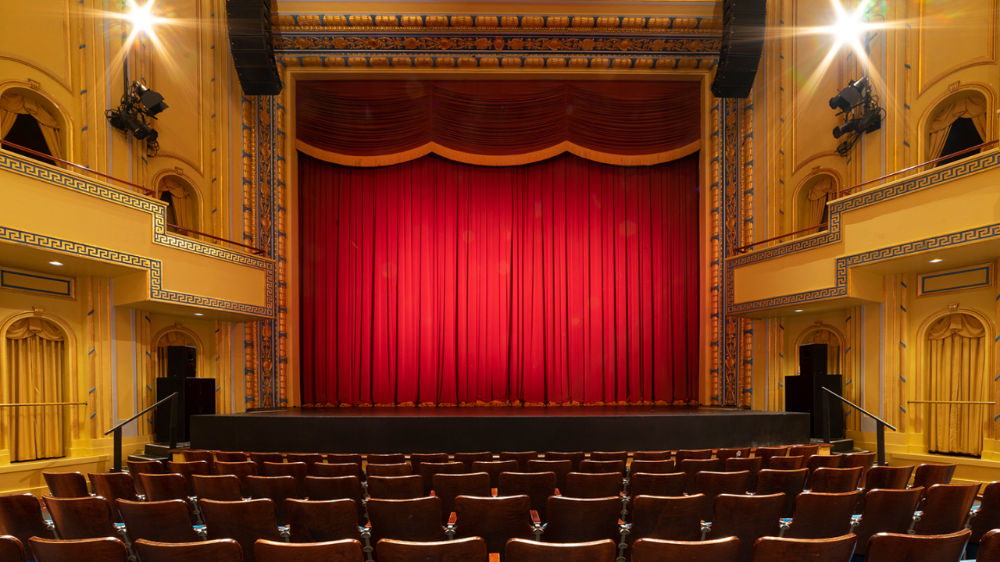

# Noticing Alcohol Scripts

An *alcohol script* is an automatic set of thoughts, expectations, or beliefs about drinking in a specific situation. These scripts develop over time through repetition, social influence, and past experiences. 

In high-risk environments (like bars or parties), scripts can activate quickly and feel “true” without being consciously examined. Increasing awareness of these scripts is the first step toward changing behavior.

{fig-align="center"}

## Work through this worksheet to identify the automatic thoughts and expectations that show up in risky environments.  

[Click here to open this worksheet as a PDF.](https://github.com/jjcurtin/aud_support/blob/main/modules/worksheets/alcohol_script_1.pdf?raw=true)

### 1. Identify the Situation

-   **Risky environment:** []{.blank}
-   **When do you go there?** []{.blank}
-   **Who are you usually with?** []{.blank}

------------------------------------------------------------------------

### 2. Recognize the Script

What thoughts or expectations come up automatically?

Check any that apply:

-   [ ] “Drinking is expected here.”\
-   [ ] “It won’t be fun if I don’t drink.”\
-   [ ] “Everyone else is drinking.”\
-   [ ] “I’ll feel more comfortable if I drink.”\
-   [ ] “Just one won’t hurt.”\
-   [ ] “I deserve this.”\
-   [ ] Other: []{.blank}

------------------------------------------------------------------------

### 3. Write Your Script

Put your typical thought into one sentence:

------------------------------------------------------------------------

### 4. Notice the Impact

-   When this thought shows up, what do you tend to do?\
-   How strong is the urge that follows (0–10)? []{.blank}

------------------------------------------------------------------------

### Quick Reflection

-   Does this script feel automatic?\
-   Does it feel true in the moment?

::: {.callout-note title="Remember"}
Awareness creates a pause. That pause creates choice.
:::
