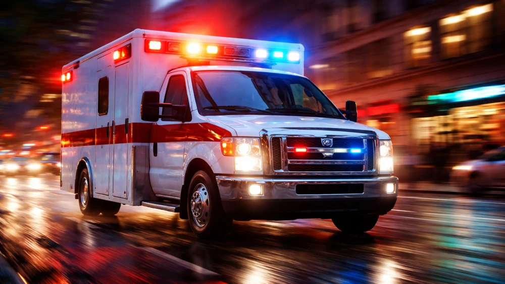

## Personal Emergency Plan

Use this worksheet to prepare for [high-risk situations](psychoed_risky_situation.html). Review it regularly and use it during moments of craving or stress. 

::: {.callout-important}
### If I encounter a life event that puts me in a high-risk situation:

1.  I will leave or change the situation or environment.

2.  I will put off the decision to drink for **15 minutes**. I will remember that most cravings are time-limited and I can wait it out.

3.  I will challenge my thoughts about drinking.

    -   Do I really need a drink?

    -   My only true needs are air, water, food, and shelter.

4.  I will think of something unrelated to drinking.

5.  I will remind myself of my successes to this point.
:::

{fig-align="center"}

## Emergency Contact List

[Click here to open this worksheet as a PDF.](https://github.com/jjcurtin/aud_support/blob/main/modules/worksheets/emergency_plan.pdf?raw=true)

| \# | Name | Phone Number |
|----|------|--------------|
| 1. |  |  |
| 2. |  |  |
| 3. |  |  |
| 4. |  |  |
| 5. |  |  |
| 6. |  |  |

: {tbl-colwidths="[10,50,40]"}

------------------------------------------------------------------------

**You got this!**

::: {.callout-note title="Remember"}
Riding out this crisis will strengthen your recovery.
:::
